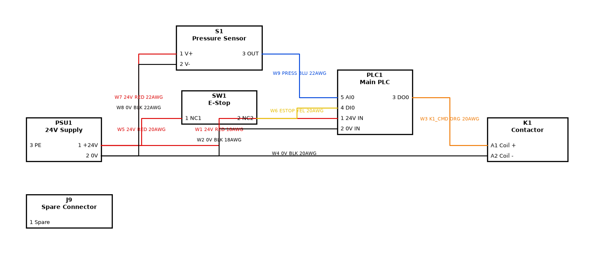

# Visio Wiring Diagram

Generate a wiring diagram in Microsoft Visio from an Excel spreadsheet.

You keep a **Devices** sheet (every pin of every device) and a **Wires** sheet (every wire, pin to pin) like a netlist. The program validates them, lays the diagram out automatically, and draws it in Visio as plain boxes, labeled pins and glued connectors. The result is a normal `.vsdx` you can edit by hand.



```
wiring.xlsx --> validate --> auto layout --> layout.json + preview.png
                                                  |
                                                  +--> Visio (.vsdx)   (Windows + desktop Visio)
```

Everything except the last step runs on any machine with Python. Only the Visio step needs Windows and desktop Visio (Plan 2 or Professional; Visio for the web does not support COM automation).

## 1. Install

Requires Python 3.10+.

```powershell
python -m venv .venv
.\.venv\Scripts\Activate.ps1
pip install -r requirements.txt
```

## 2. Try the sample

```powershell
python make_sample.py          # writes wiring_sample.xlsx
python build.py wiring_sample.xlsx
```

This prints any validation warnings and writes:

- `layout.json` - box positions, pins and wires (the input to the Visio step)
- `preview.png` - a quick picture of the layout, no Visio needed

Open `preview.png` to check the layout. To also draw it in Visio:

```powershell
python build.py wiring_sample.xlsx --visio wiring_sample.vsdx
```

Visio opens, the diagram is drawn, and the file is saved at the path you give.

## 3. Prepare your spreadsheet

Use one workbook with two sheets named `Devices` and `Wires`, or two separate workbooks (see `--wires` below). If a sheet name isn't found, the first sheet of the file is used. Column names must match exactly; extra columns are ignored.

**Devices sheet** - one row per pin:

| RefDes | Description | Pin | PinName |
|---|---|---|---|
| PSU1 | 24V Supply | 1 | +24V |
| PSU1 | 24V Supply | 2 | 0V |
| PLC1 | Main PLC | 1 | 24V IN |
| K1 | Contactor | A1 | Coil + |

- `RefDes` (required) - unique device name, shown in the box header and used by the Wires sheet.
- `Pin` (required) - pin/terminal number, unique within a device. Text is fine (`A1`).
- `Description`, `PinName` (optional) - shown in the box and next to the pin.

**Wires sheet** - one row per wire:

| WireID | FromRef | FromPin | ToRef | ToPin | Signal | Color | Gauge |
|---|---|---|---|---|---|---|---|
| W1 | PSU1 | 1 | PLC1 | 1 | 24V | RED | 18AWG |
| W3 | PLC1 | 3 | K1 | A1 | K1_CMD | ORG | 20AWG |

- `WireID`, `FromRef`, `FromPin`, `ToRef`, `ToPin` are required. `Signal`, `Color`, `Gauge` are optional.
- The connector is labeled with the ID, signal, color and gauge.
- The line takes its color from the first word of `Color`. Known names (`RED`, `BLK`, `BLU`, `GRN`, `YEL`, `ORG`, `WHT`, `BRN`, `VIO`, `GRY` and their long forms) are in [colors.py](colors.py); unknown colors draw black. Edit that file to add your own.

## 4. Build

```powershell
python build.py wiring.xlsx                          # one workbook with both sheets
python build.py devices.xlsx --wires wires.xlsx      # two workbooks
python build.py wiring.xlsx --visio wiring.vsdx      # also draw in Visio
```

| Option | Default | Meaning |
|---|---|---|
| `--wires FILE` | same as devices file | workbook containing the Wires sheet |
| `--json FILE` | `layout.json` | layout output |
| `--png FILE` | `preview.png` | preview image output |
| `--visio FILE` | off | draw and save a Visio file |

### Validation

Errors stop the build and report the spreadsheet row:

```
ERRORS:
  - Wires row 2 (W1): PLC1 has no pin '99'
  - Wires row 3 (W2): unknown device 'NOPE'
  - Wires row 4: duplicate WireID W1
```

Checked: missing columns, duplicate device pins, duplicate wire IDs, unknown devices or pins, and a wire connecting a pin to itself.

Warnings don't stop the build: a pin used by several wires (normal for power rails) and devices with no wires.

## 5. Two-machine workflow

If the machine with Visio shouldn't need Excel parsing, or you prefer to build elsewhere:

1. On any machine, run `python build.py wiring.xlsx` and review `preview.png`.
2. Copy the folder (or just `layout.json`, `visio_draw.py` and `colors.py`) to the Visio machine.
3. There, install only `pywin32` and run:

```powershell
python visio_draw.py layout.json wiring.vsdx
```

## 6. Editing in Visio

- Each device box has Shape Data `RefDes` and `Description`. Each wire has `WireID`, `Signal`, `Color` and `Gauge` (right-click > Data > Shape Data).
- Pins are small shapes inside the box; connectors are glued to them, so moving a box keeps the wires attached.
- The layout puts each pin on the side facing the device it connects to. A wire that skips a column can pass over a box in between; drag the connector's elbow to fix it.

## Limitations

- Each run draws a **new** drawing. It does not update one you've edited by hand, so keep hand edits in the generated file and re-run only when the netlist changes substantially.
- The Visio drawing step (`visio_draw.py`) needs desktop Visio and was written against the Visio object model; if it fails on your version, open an issue with the error message.
- One page only; very large netlists produce a large page.

## Files

| File | Purpose |
|---|---|
| `build.py` | command-line entry point |
| `netlist.py` | reads and validates the spreadsheets |
| `layout.py` | automatic layout (layered, left to right) |
| `preview.py` | writes the PNG preview |
| `visio_draw.py` | draws the layout in Visio via COM |
| `colors.py` | wire color names to RGB |
| `make_sample.py` | creates `wiring_sample.xlsx` |
